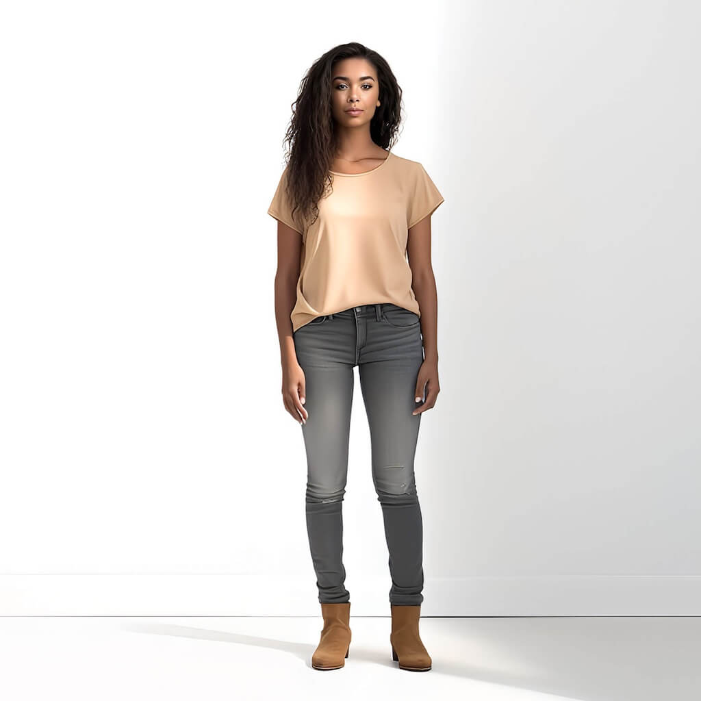
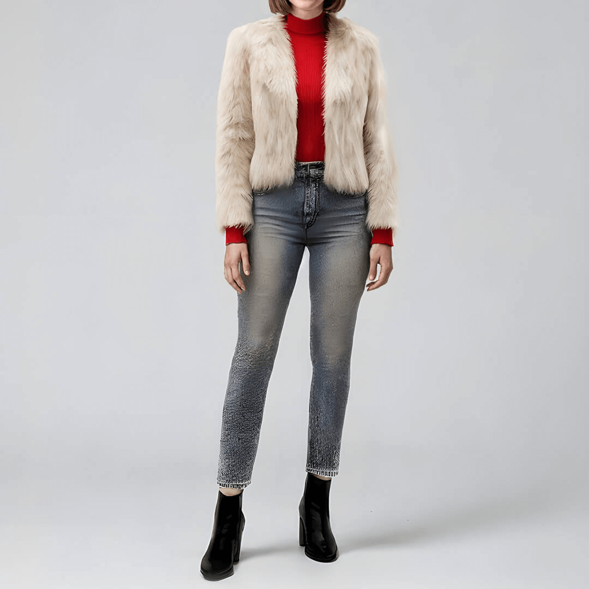
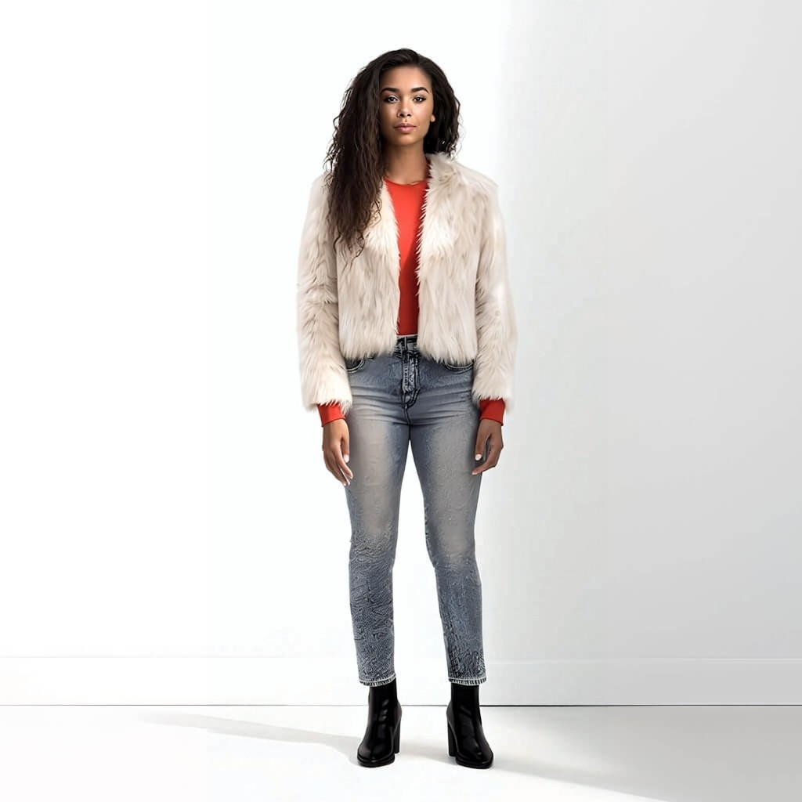

# First verified YouCam Clothes API run

Date: 16 October 2026. Result: **INTEGRATION_TEST PASS**, with qualitative visual review.

- Provider: Perfect Corp YouCam, cloth-v4.
- One task created; five API requests including polling.
- Processing time: 33.474 seconds.
- Output: result.jpg, 73,094 bytes, 1024 × 1024 pixels.
- Durable evidence: run-95e1761f.json, including hashes of both inputs, output and client/script source.
- API key and signed output URL are excluded.

| Source person | Reference outfit | Actual provider output |
| --- | --- | --- |
|  |  |  |

The source person wears a beige shirt, dark trousers and tan boots. The reference outfit includes a red top, cream fur-style jacket, grey patterned jeans and black boots. The generated output transfers these outfit elements while retaining a visually consistent person and standing pose.

This is a saved result of one real API execution. It is not a continuously running live session or a quantitative validation of identity preservation, fit or fabric fidelity.

Inputs were the public samples from the [official Clothes API guide](https://docs.perfectcorp.com/reference/ai_clothes). Review third-party asset rights before public redistribution.

The same application client is used by /api/try-on, but this evidence was obtained through the proof command, not a recorded browser interaction with that route. File upload was bypassed by the documented public-URL workflow and remains unverified against the provider.

Skin AI live mapping, accessories, externally accessible judge demo, final video and final submission are still incomplete or unverified.
